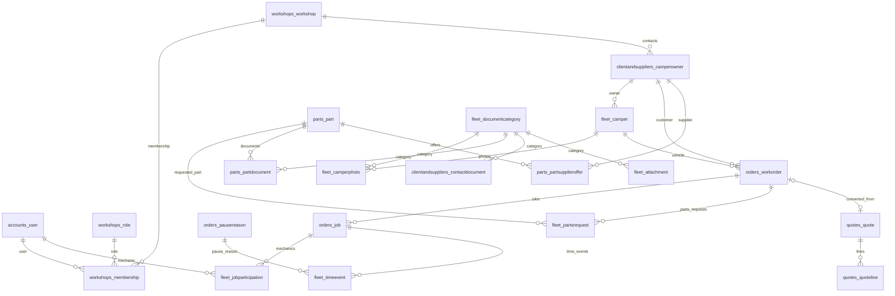

# Database PostgreSQL RVKeeper

Questa pagina documenta come collegarsi al database PostgreSQL, esplorare le tabelle e seguire le relazioni. Il modello usa PostgreSQL da `config/settings.py`; le credenziali non sono incluse nel vault o nel repository.

> [!warning] Configurazione necessaria
> Il file `.env` recuperato dal server e presente e i nomi delle variabili sono allineati a `config/settings.py`. Contiene credenziali: non copiarne i valori in Obsidian, non stamparli nei log e non committarlo. Il test read-only verso PostgreSQL locale ha raggiunto il server, ma l autenticazione password e stata rifiutata; le credenziali del file non corrispondono all istanza locale oppure vanno aggiornate.

> [!danger] Attenzione al database target
> Non eseguire `migrate`, `dropdb` o modifiche SQL finche non sono disponibili credenziali valide per il database nuovo e vuoto. Il servizio locale risponde sulla porta 5432, ma il collegamento autenticato non e riuscito.


## Creazione del database vuoto

Le migrazioni storiche sono già state sostituite da migrazioni iniziali pulite per il nuovo schema. I file `0001_initial.py`, gli eventuali `0002_initial.py`/`0003_initial.py` e il seed `fleet/0004_initial_admin_catalogs.py` fanno parte della nuova definizione: alcuni initial sono divisi per risolvere le dipendenze circolari tra app. Non cancellarli, perché `migrate` li usa per creare le tabelle.

Dopo aver verificato il target e configurato credenziali valide:

```powershell
# Non sovrascrivere il .env esistente. Verificare DB_NAME, DB_USER, DB_HOST e DB_PORT.
python manage.py migrate
python manage.py createsuperuser
```

Il comando `migrate` crea lo schema nel database indicato da `.env`; non crea il database PostgreSQL stesso. Un amministratore può crearlo con pgAdmin oppure, se l'utente PostgreSQL ha il privilegio `CREATEDB`:

```powershell
createdb -h 127.0.0.1 -p 5432 -U <utente> <nome_database>
```

Per creare davvero un database nuovo, usare pgAdmin o `createdb` con un nome nuovo e confermato. Non eseguire `dropdb` sul target configurato dal `.env` di produzione. Dopo aver verificato che `DB_NAME` punti al database vuoto appena creato, applicare le migrazioni con `python manage.py migrate`.

## Sessione `psql`

Avviare PowerShell nella root del progetto. La password viene richiesta interattivamente e non va inserita nella riga di comando:

```powershell
$env:PGHOST = "127.0.0.1"
$env:PGPORT = "5432"
$env:PGDATABASE = "<DB_NAME>"
$env:PGUSER = "<DB_USER>"
& "C:\Program Files\PostgreSQL\18\bin\psql.exe" -W
```

Comandi utili dentro `psql`:

```sql
\conninfo                 -- connessione corrente
\l                        -- database visibili
\dt                       -- tabelle nello schema corrente
\dt public.*              -- tabelle dello schema public
\d+ public.orders_workorder -- colonne, indici e vincoli di una tabella
\dn                       -- schemi
\q                        -- esci
```

Per elencare le chiavi esterne e vedere da quale tabella puntano:

```sql
SELECT
    tc.table_name AS tabella,
    kcu.column_name AS colonna,
    ccu.table_name AS tabella_riferita,
    ccu.column_name AS colonna_riferita,
    tc.constraint_name AS vincolo
FROM information_schema.table_constraints AS tc
JOIN information_schema.key_column_usage AS kcu
  ON tc.constraint_name = kcu.constraint_name
 AND tc.table_schema = kcu.table_schema
JOIN information_schema.constraint_column_usage AS ccu
  ON ccu.constraint_name = tc.constraint_name
 AND ccu.table_schema = tc.table_schema
WHERE tc.constraint_type = 'FOREIGN KEY'
  AND tc.table_schema = 'public'
ORDER BY tc.table_name, kcu.column_name;
```

## Consultare e modificare righe

Prima consultare la struttura e limitare le letture:

```sql
SELECT id, ro_number, status, created_at
FROM public.orders_workorder
ORDER BY id DESC
LIMIT 50;
```

Le modifiche ai dati si possono provare in una transazione e annullare prima del commit:

```sql
BEGIN;
UPDATE public.orders_workorder
SET reception_notes = 'Nota aggiornata'
WHERE id = 123;
SELECT id, ro_number, reception_notes
FROM public.orders_workorder
WHERE id = 123;
ROLLBACK; -- usare COMMIT solo dopo aver verificato la modifica
```

Preferire l'interfaccia RVKeeper o Django ORM per mantenere audit, validazioni e regole applicative. Modificare manualmente lo schema con `ALTER TABLE` evita lo storico Django: per cambiare colonne o vincoli modificare i modelli, generare una migrazione e applicarla.

Per aprire la stessa connessione configurata a Django si può usare `python manage.py dbshell` (richiede il client `psql` disponibile nel `PATH`). Per interrogare l'ORM:

```powershell
python manage.py shell
```

```python
from orders.models import WorkOrder
WorkOrder.objects.select_related("customer", "vehicle").order_by("-created_at")[:20]
```

## Mappa relazionale in Obsidian

Ogni tabella applicativa ha una nota dedicata con colonne, riferimenti, vincoli e link alle tabelle collegate. Aprire le note da questa lista o usare la vista **Grafo** di Obsidian.

### Officina e accessi

- [[DB - workshops_workshop]]
- [[DB - workshops_role]]
- [[DB - workshops_membership]]
- [[DB - accounts_user]]

### Clienti, camper e documenti

- [[DB - clientandsuppliers_camperowner]]
- [[DB - clientandsuppliers_contactdocument]]
- [[DB - fleet_camper]]
- [[DB - fleet_camperphoto]]
- [[DB - fleet_documentcategory]]

### Preventivi e ordini

- [[DB - quotes_quote]]
- [[DB - quotes_quoteline]]
- [[DB - orders_workorder]]
- [[DB - orders_job]]
- [[DB - orders_jobcall]]
- [[DB - orders_pausereason]]
- [[DB - fleet_jobparticipation]]
- [[DB - fleet_timeevent]]
- [[DB - fleet_jobassignment]]
- [[DB - fleet_jobnote]]

### Magazzino e fornitori

- [[DB - parts_part]]
- [[DB - parts_partsupplieroffer]]
- [[DB - parts_partdocument]]
- [[DB - parts_partmovement]]
- [[DB - fleet_partsrequest]]

### Garanzie, allegati e tracciamento

- [[DB - fleet_warrantyclaim]]
- [[DB - fleet_warrantyreturn]]
- [[DB - fleet_attachment]]
- [[DB - fleet_notification]]
- [[DB - fleet_auditlog]]



> [!info] Tabelle Django
> Oltre alle tabelle applicative RVKeeper, Django crea `django_migrations`, `django_session`, `django_content_type`, `auth_permission`, `auth_group`, le tabelle di relazione dei gruppi/permessi e `django_admin_log`. Il nome esatto dipende dalle migrazioni standard della versione Django installata.
