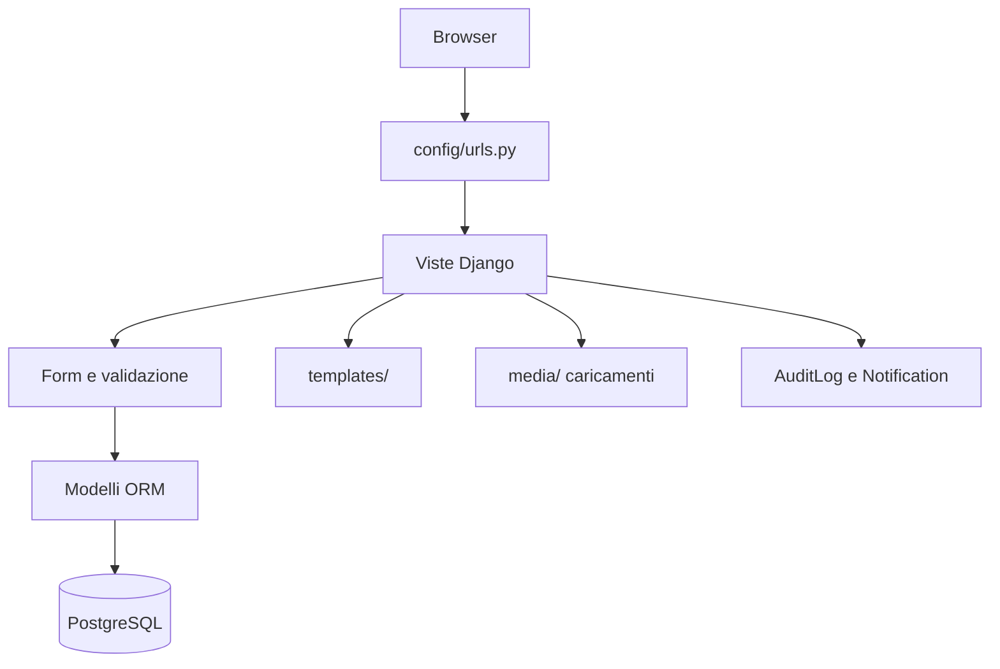
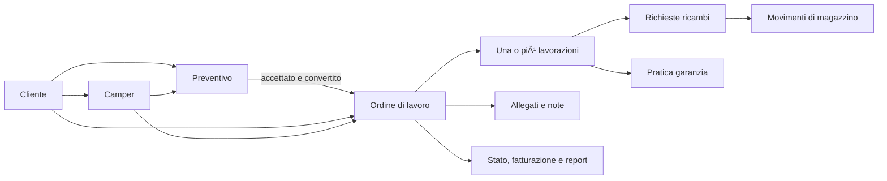
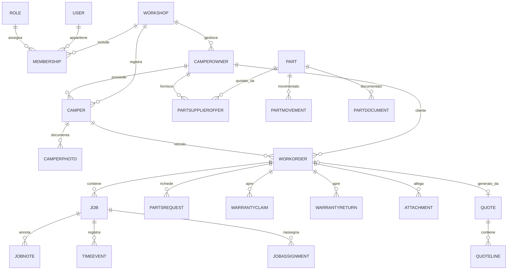

# RVKeeper  documentazione progetto

> [!abstract] Scopo
> RVKeeper è un'applicazione web per gestire il flusso operativo di un'officina che lavora su camper: anagrafiche, parco mezzi, preventivi, ordini di lavoro, attività dei tecnici, ricambi, garanzie, resi, notifiche e report.

Questa nota descrive il repository dopo la riprogettazione dello schema. Le migrazioni iniziali sono state rigenerate per le app di dominio: in un ambiente nuovo lo schema viene creato con `python manage.py migrate`. Non è stata eseguita una conversione/migrazione dati da un vecchio database, coerentemente con il fatto che il progetto è ancora pre-produzione.

## Indice

- [[#Panoramica tecnica]]
- [[#Avvio e configurazione]]
- [[Deployment Linux RVKeeper]]
- [[#Architettura del codice]]
- [[#Funzionamento applicativo]]
- [[#Interfaccia smartphone e desktop]]
- [[#Database e relazioni]]
- [[Database PostgreSQL RVKeeper]]
- [[#URL e schermate]]
- [[#Utenti e accessi]]
- [[#File e documenti caricati]]
- [[#Manutenzione e punti da verificare]]
- [[#Mappa dei file]]

## Panoramica tecnica

| Aspetto | Dettaglio |
|---|---|
| Framework | Django 6.1.3 |
| Linguaggio | Python |
| Database configurato | PostgreSQL tramite `psycopg` |
| Configurazione ambiente | `python-dotenv`, file `.env` letto dalla root |
| Interfaccia | Template Django, CSS responsive e navigazione asincrona desktop |
| Autenticazione | Django Auth con modello utente personalizzato |
| PDF | `reportlab` (intervallo `>=4.2,<5`) |
| Immagini | Pillow |
| Lingue dichiarate | inglese e italiano nel settings; lingua utente anche francese, tedesco e spagnolo |
| Fuso orario Django | UTC, con `USE_TZ=True` |

Il progetto è organizzato in app Django per dominio. `fleet` contiene il parco mezzi e i flussi trasversali; `orders`, `parts`, `quotes` e `clientandsuppliers` possiedono modelli e tabelle separate per area funzionale.

## Avvio e configurazione

Il file `manage.py` è l'entry point dei comandi Django. Le dipendenze sono in `requirements.txt`. Le impostazioni comuni leggono `.env` dalla root del repository; `config/production_settings.py` aggiunge gli override di produzione e viene selezionato dal servizio Gunicorn. Per una nuova macchina Linux usare [[Deployment Linux RVKeeper]], che genera una configurazione locale senza sovrascrivere `.env` esistenti.

Variabili attese per PostgreSQL:

| Variabile | Uso |
|---|---|
| `DB_NAME` | Nome database |
| `DB_USER` | Utente database |
| `DB_PASSWORD` | Password database |
| `DB_HOST` | Host database |
| `DB_PORT` | Porta; fallback `5432` |
| `DJANGO_CSRF_TRUSTED_ORIGINS` | Origini consentite per i POST; devono usare lo schema del sito |
| `DJANGO_SECURE_COOKIES` | Cookie sessione/CSRF secure quando HTTPS è attivo |
| `RVKEEPER_SERVER_NAME` | Host configurato da Nginx |
| `RVKEEPER_TLS_CERTIFICATE`, `RVKEEPER_TLS_KEY` | Percorsi del certificato e della chiave TLS, se HTTPS è attivo |
| `EMAIL_BACKEND` | Backend email; fallback al backend console Django |

`DJANGO_SECRET_KEY`, `DJANGO_DEBUG`, `DJANGO_ALLOWED_HOSTS` e `DJANGO_CSRF_TRUSTED_ORIGINS` vengono letti dall'ambiente. `DEBUG` e falso per default. `config/settings.py` contiene la base condivisa e i default di sviluppo; `config/production_settings.py` richiede una chiave segreta e configura cookie HTTPS, redirect e host in base alle variabili d'ambiente. In produzione raccogliere gli asset con `collectstatic` e servirli tramite Nginx.

Comandi di sviluppo usuali (da eseguire nell'ambiente Python del progetto):

```powershell
python -m venv .venv
.\.venv\Scripts\Activate.ps1
pip install -r requirements.txt
python manage.py migrate
python manage.py createsuperuser
python manage.py runserver
```

Per un database vuoto: creare le variabili `DB_*` nel `.env`, poi eseguire `python manage.py migrate` e `python manage.py createsuperuser`. Su Debian/Ubuntu lo script di [[Deployment Linux RVKeeper]] automatizza il provisioning locale di PostgreSQL, virtualenv, superuser, officina demo, seed, Gunicorn e Nginx. Non copiare mai `.env` o credenziali di una macchina nel repository: `.env.example` documenta i nomi delle variabili e non contiene segreti.

### Popolamento dati dimostrativi

Il comando `python manage.py populate_demo_data` crea un dataset fittizio per un'officina attiva con `country=US`: 12 contatti (clienti, fornitori e profili con entrambi i ruoli), 12 articoli con offerte fornitore e 12 camper assegnati ai clienti. Email `.example`, telefoni `555` e identificativi `DEMO`/`TEST` rendono riconoscibili i dati di prova; non vengono aggiunti file o immagini.

Se esiste una sola officina USA attiva, il comando la seleziona automaticamente. Se ce ne sono piu di una, specificare lo slug:

```powershell
python manage.py populate_demo_data --workshop <slug-officina-USA>
```

Il comando è idempotente: usa email, codice articolo, numero interno e coppia articolo/fornitore come chiavi; crea solo i record mancanti e non elimina né aggiorna quelli già esistenti. La macchina che esegue il seed deve avere un'officina attiva con `country=US`.

## Architettura del codice



### App e responsabilità

| App/cartella | Responsabilità |
|---|---|
| `config` | Settings, URL root, WSGI/ASGI e ordinamento admin |
| `accounts` | Utente personalizzato, manager, form e admin utenti |
| `workshops` | Officine, ruoli e appartenenze utente-officina |
| `fleet` | Camper e foto; viste principali dashboard, flussi, report, notifiche, audit ed export; modelli operativi storici |
| `clientandsuppliers` | Anagrafica clienti/fornitori e relativi form, viste e URL |
| `orders` | Ordini di lavoro e lavorazioni: viste e URL, modelli `WorkOrder` e `Job` |
| `quotes` | Preventivi, righe, stato, form e conversione in ordine |
| `parts` | Articoli, offerte fornitore, documenti e movimenti di magazzino |
| `templates` | HTML per dashboard, moduli, liste, dettagli, autenticazione e admin |
| `static` | Logo, sfondo e CSS admin |
| `UserManual` | Manuale amministrativo in formato DOCX |

### Confini tra le app

I modelli sono registrati nell'app in cui vivono: `orders`, `quotes`, `parts`, `clientandsuppliers` e `fleet`. Le migrazioni storiche sono state rimosse e rigenerate come migrazioni iniziali pulite. Non c'è una migrazione dati automatica dal vecchio schema. `CamperOwner` ha il nome unico nel nuovo codice, senza alias `BusinessPartner`.

## Funzionamento applicativo

### Flusso principale del lavoro



### Interfaccia smartphone e desktop

L'interfaccia si adatta alla larghezza della viewport, senza richiedere un'app installata. La soglia corrente e 760 pixel: smartphone e finestre strette mantengono il layout mobile esistente, con menu laterale a scomparsa e contenuti impilati. La navigazione asincrona e attiva solo oltre tale soglia.

Su desktop e schermi ampi il CSS aggiunge una presentazione gestionale piu densa: barra superiore compatta, navigazione laterale persistente, schede riepilogative, tabelle e gerarchia visiva piu marcate. La foto `static/images/rv-background.webp` torna visibile sullo sfondo desktop, attenuata da un velo scuro; le schede chiare mantengono il contrasto per i testi. Il JavaScript carica le navigazioni interne e i moduli GET/POST in background, sostituendo il contenuto centrale senza ricaricare l'intero documento. Aggiorna titolo e URL, supporta avanti/indietro del browser, mostra un indicatore di caricamento e mantiene il normale caricamento pagina come fallback. I template e gli endpoint Django restano la fonte dei contenuti: non e una SPA client-side autonoma.

Il comportamento e implementato in `static/css/app.css` e `static/js/app.js`, inclusi da `templates/base.html`. La navigazione asincrona riguarda l'area autenticata del sito e non intercetta `/admin/`, che mantiene il pannello standard Django. Il breakpoint e basato sulla larghezza, non sul riconoscimento del modello del dispositivo: ruotando uno smartphone o ridimensionando la finestra puo cambiare il layout.

Per provare localmente gli asset con `runserver`, fermare il server e avviarlo da PowerShell impostando `$env:DJANGO_DEBUG = "true"` prima del comando `runserver`; poi ricaricare senza cache (Ctrl+F5). La variabile vale per quella sessione PowerShell e non modifica il `.env` se non viene salvata.

### Uso da telefono e collaborazione dei meccanici

Le pagine usano layout responsive e funzionano dal browser di tablet e smartphone; non serve un'app installata. Con un account meccanico, **Le mie lavorazioni** mostra le chiamate ricevute. Una chiamata accettata avvia la sessione del tecnico; da lì si può mettere in pausa scegliendo una causale amministrabile, riprendere o terminare il proprio tempo. Dalla lista generale ogni meccanico può anche unirsi autonomamente a una lavorazione aperta.

La collaborazione è molti-a-molti: lo stesso `Job` può avere N record `JobParticipation` e più sessioni simultanee, una per tecnico. Il tempo è attribuito alla persona che ha generato gli eventi, non a un unico tecnico responsabile. La chiusura avviene quando l'ultimo partecipante attivo termina la propria sessione. Il livello `senior`/`manager` o l'accesso staff consente la riapertura, che viene registrata come evento.

### Anagrafiche e veicoli

Un contatto commerciale può essere cliente, fornitore o entrambi. Può rappresentare una persona o un'azienda. Le validazioni richiedono ragione sociale per un'azienda e nome/cognome per un privato. Un contatto già collegato a veicoli o ordini non può perdere il ruolo cliente; se è collegato a offerte ricambi non può perdere il ruolo fornitore.

Il camper contiene identificativi (numero interno, targa e VIN), proprietario, marca/modello, dati di immatricolazione e motorizzazione, dimensioni, masse, chilometraggio, note e stato attivo. Può avere più foto. Il proprietario viene scelto fra i clienti della stessa officina.

### Preventivi

Un preventivo ha numero univoco per officina, cliente, eventuale veicolo, stato e righe. Gli stati sono bozza, inviato, accettato, rifiutato e scaduto. Le righe sono ricambio, manodopera o altro; riportano quantità, unità, prezzo, sconto e tempo standard. Subtotale e totale sono calcolati dalle righe con aritmetica decimale.

La modifica è prevista per preventivi in bozza non ancora convertiti. La conversione è un POST transazionale: accetta soltanto preventivi approvati non convertiti, crea un ordine di lavoro e genera richieste ricambi dalle righe di tipo ricambio e lavorazioni dalle altre righe. L'ordine e il preventivo vengono collegati e l'operazione è registrata nell'audit.

### Ordini di lavoro e lavorazioni

L'ordine di lavoro (OdL / RO) collega officina, cliente e, facoltativamente, camper. Salva anche una fotografia dei dati cliente/veicolo (nome, contatti, marca/modello e odometro), oltre a classificazione, stato, note di accettazione, checklist e danni. Il numero RO è univoco per officina.

Stati OdL: aperto, in lavorazione, attesa collaudo, pronto consegna, lavori aggiuntivi, chiuso, annullato. La fatturazione è rappresentata da flag e data/utente. Ogni OdL raggruppa più `Job` numerati: reparto, specialità, tecnico assegnato e tecnico attivo, stato, tempo standard, minuti netti e di attesa, motivi di blocco, informazioni garanzia e disponibilità ricambi.

Le lavorazioni possono registrare eventi temporali (avvio, pausa, fine, attesa), note, riassegnazioni e allegati. Gli stati Job includono non iniziato, in corso, in pausa, attesa ricambi, attesa garanzia, completato e annullato.

### Magazzino e approvvigionamento

Ogni ricambio ha codice univoco per officina, descrizione, unità, costo, prezzo vendita, tempo standard, quantità, soglia minima e ubicazione. Le offerte collegano un ricambio a un fornitore e memorizzano codice fornitore, prezzo acquisto, sconto, quantità minima, tempi di consegna e preferenza. Un'offerta marcata preferita aggiorna il costo del ricambio al prezzo netto.

`PartMovement` conserva carichi, scarichi e rettifiche, facoltativamente collegati a un OdL. La vista esegue la variazione della giacenza dentro una transazione con lock della riga articolo, impedisce quantità negative e salva il movimento e una voce audit. La rettifica esprime la quantità finale desiderata; il movimento memorizza la differenza.

Le richieste ricambi sono legate all'OdL e, opzionalmente, alla lavorazione, all'articolo, all'offerta e a una pratica garanzia. Tracciano quantità richiesta/consegnata, unità, fornitore, prezzo concordato, stato e indicatore `inventory_applied`. Gli stati comprendono nuovo, in attesa, in preparazione, pronto al ritiro, consegnato e annullato.

### Garanzie, resi, note e allegati

- `WarrantyClaim`: richiesta di copertura collegata a OdL e opzionalmente a Job; descrizione difetto/lavoro, ore richieste e approvate, decisione, foto e utenti/data della decisione.
- `WarrantyReturn`: reso ricambio collegato a OdL e facoltativamente a Job/richiesta; identifica articolo, quantità, seriale, difetto, data ricezione ed esito (reso, sostituzione, accredito o rifiuto).
- `JobNote`: testo associato a una lavorazione, con autore, reparto, lingua e campo JSON per traduzioni.
- `Attachment`: file riferibile a un OdL e/o a un Job, con descrizione, reparto e autore.
- `CamperPhoto`: immagine appartenente a un camper.
- `PartDocument`: foto o scheda tecnica di un ricambio.

### Dashboard, notifiche, audit e report

La dashboard aggrega dati operativi per l'officina dell'utente. Il codice crea notifiche per giacenze sotto o uguali alla soglia minima, evitando duplicati solo rispetto a una combinazione di campi/query specifica (notifica generica non letta con stesso titolo/link). Le notifiche possono essere globali all'officina (`user = NULL`) o indirizzate a un utente.

`AuditLog` conserva officina, attore, azione, tipo/id entità, eventuale OdL, dettagli e timestamp. Le viste di contatti e alcune modifiche di flusso non scrivono tutte necessariamente lo stesso livello di audit; consultare i singoli handler prima di assumere copertura completa.

Sono presenti una vista report, un registro attività e un endpoint di esportazione dati. L'OdL ha anche un endpoint per generare un prospetto PDF. Consultare i relativi handler in `fleet/views.py` e `orders/views.py` per formato, campi inclusi e autorizzazioni effettive.

## Database e relazioni

Per istruzioni pratiche di connessione, query, modifica dati e navigazione delle singole tabelle in Obsidian, consulta [[Database PostgreSQL RVKeeper]].

### Configurazione e convenzioni

Il backend configurato e PostgreSQL tramite le variabili `DB_*`. Le migrazioni iniziali si trovano nelle cartelle `migrations` delle app di dominio. I modelli usano il prefisso dell app proprietaria, per esempio `orders_workorder`, `parts_part` e `clientandsuppliers_camperowner`. Django aggiunge anche le proprie tabelle per sessioni, permessi, log admin e migrazioni.

Legenda: `1:N` indica uno-a-molti; `N:M` molti-a-molti; `1:1` uno-a-uno. I nomi in corsivo sono relazioni logiche; il nome fisico dei vincoli/colonne segue Django.

### Entita e chiavi principali

| Entità (modello) | Tabella Django attesa | Ruolo e campi notevoli |
|---|---|---|
| `Workshop` | `workshops_workshop` | Tenant/officina: nome, slug, paese, lingua, timezone, valuta, attivo |
| `Role` | `workshops_role` | Ruolo per officina, codice, descrizione, permessi Django, flag sistema |
| `Membership` | `workshops_membership` | Collegamento utente-officina-ruolo, attivo; un solo record per coppia utente/officina |
| `User` | `accounts_user` | Utente Django personalizzato, username, email, lingua, reparto, specialità e livello operativo |
| `CamperOwner` | `clientandsuppliers_camperowner` | Anagrafica persona/azienda e tipo cliente/fornitore |
| `ContactDocument` | `clientandsuppliers_contactdocument` | Allegati classificati per clienti e fornitori |
| `Camper` | `fleet_camper` | Scheda camper, proprietario, caratteristiche tecniche e operative |
| `CamperPhoto` | `fleet_camperphoto` | Immagini e didascalie del camper |
| `WorkOrder` | `orders_workorder` | Ordine/RO, cliente, veicolo, stato, note, chiusura/fatturazione |
| `Job` | `orders_job` | Lavorazione dell'ordine, stato e tempi standard |
| `JobCall` | `orders_jobcall` | Chiamata personale a un meccanico, accettazione e storico |
| `PauseReason` | `orders_pausereason` | Causali pausa configurabili in admin |
| `Quote` | `quotes_quote` | Preventivo cliente e collegamento eventuale all'OdL generato |
| `QuoteLine` | `quotes_quoteline` | Riga preventivo, quantità, prezzo, sconto e tempo |
| `Part` | `parts_part` | Catalogo ricambi e giacenza corrente |
| `PartSupplierOffer` | `parts_partsupplieroffer` | Prezzo e condizioni di un fornitore per un ricambio |
| `PartDocument` | `parts_partdocument` | Allegato classificato, ripetibile per ogni ricambio |
| `PartMovement` | `parts_partmovement` | Registro carico/scarico/rettifica |
| `PartsRequest` | `fleet_partsrequest` | Richiesta di approvvigionamento collegata a OdL/Job |
| `WarrantyClaim` | `fleet_warrantyclaim` | Richiesta di autorizzazione garanzia |
| `WarrantyReturn` | `fleet_warrantyreturn` | Pratica di reso/sostituzione/accredito |
| `JobNote` | `fleet_jobnote` | Note e traduzioni per lavorazione |
| `Attachment` | `fleet_attachment` | File classificato allegato a OdL/Job |
| `Notification` | `fleet_notification` | Avviso per utente o officina |
| `TimeEvent` | `fleet_timeevent` | Eventi di rilevazione tempo del Job |
| `JobAssignment` | `fleet_jobassignment` | Storico trasferimento assegnazione Job |
| `JobParticipation` | `fleet_jobparticipation` | Sessione personale di ciascun meccanico su una lavorazione |
| `DocumentCategory` | `fleet_documentcategory` | Catalogo admin per classificare allegati e foto |
| `AuditLog` | `fleet_auditlog` | Registro attività applicativa |

I nomi tabellari sono la convenzione `app_label_modelname`. Gli utenti Django usano `accounts_user`; officine/ruoli/appartenenze usano il prefisso `workshops_`. Le migrazioni nuove non usano più l'etichetta storica `fleet` per clienti, ordini, articoli o preventivi.

### Relazioni principali



In particolare:

- `Membership` è univoco su `(user, workshop)`; il suo `Role` deve appartenere alla stessa officina.
- `CamperOwner`, `Camper`, `WorkOrder`, `Job`, `Part`, preventivo e richieste portano un riferimento all'officina (diretto o tramite il padre). La logica applicativa filtra generalmente i dati per l'officina attiva dell'utente.
- `WorkOrder.ro_number` e `Quote.quote_number` sono univoci per officina; anche il codice articolo è univoco per officina.
- `CamperOwner` è protetto dall'eliminazione se referenziato da camper/ordini/preventivi/offerte secondo i vincoli dichiarati.
- La cancellazione dell'officina rimuove molti dati dipendenti (`CASCADE`); cliente usato come ordine/preventivo/fornitore è spesso protetto (`PROTECT`). Veicolo eliminato può lasciare l'OdL senza veicolo (`SET_NULL`).
- `JobParticipation` associa più meccanici allo stesso `Job` e impedisce doppie partecipazioni attive dello stesso tecnico sulla stessa lavorazione. Ogni tecnico ha eventi start, pausa, ripresa e fine distinti.
- `JobCall` indirizza una chiamata a un profilo meccanico; le chiamate pendenti appaiono nella pagina **Le mie lavorazioni** e possono essere accettate dal telefono/tablet.
- Una lavorazione è chiusa quando l'ultimo meccanico termina la propria sessione. La riapertura è consentita a `Meccanico senior`, `Responsabile`, staff o superuser; il livello è gestito sul profilo utente dall'admin.
- I dati JSON (`checklist`, `damages`, `documents`, `defect_photos`, `photos`, `translations`) rendono flessibili alcuni contenuti, ma non impongono una struttura relazionale a livello database.

### Indici e vincoli espliciti

Vincoli univoci espliciti nel codice/migrazioni:

| Modello | Vincolo |
|---|---|
| `Workshop` | `slug` univoco globalmente |
| `Membership` | `(user, workshop)` univoco |
| `Role` | `(workshop, code)` univoco |
| `Camper` | numero interno univoco per officina; targa e VIN univoci per officina quando non vuoti |
| `WorkOrder` | `(workshop, ro_number)` univoco |
| `Quote` | `(workshop, quote_number)` univoco |
| `Part` | `(workshop, part_number)` univoco |
| `PartSupplierOffer` | `(part, supplier)` univoco |

Oltre ai vincoli SQL, alcuni `clean()`/`full_clean()` applicativi verificano coerenza tra officina, cliente, veicolo, fornitore e ricambio. Queste verifiche dipendono dal percorso di scrittura: una scrittura ORM diretta che non invoca `full_clean()` potrebbe non applicarle tutte.

## URL e schermate

| Prefisso | Funzione |
|---|---|
| `/` | Dashboard |
| `/accounts/login/`, `/accounts/logout/` | Login e logout |
| `/accounts/password_reset/` e `/accounts/reset/...` | Recupero password |
| `/parco-mezzi/` | Camper, ordini correlati, moduli workflow |
| `/clienti/` | Anagrafica clienti e fornitori |
| `/ordini/` | Lista/creazione OdL, cambio stato, prospetto PDF |
| `/lavori/` | Lista/creazione lavorazioni e azioni Job |
| `/lavori/miei/` | Chiamate personali, sessioni, pausa/ripresa e chiusura del tempo |
| `/preventivi/` | Lista, creazione, dettaglio, modifica, stato e conversione OdL |
| `/magazzino/` | Catalogo articoli, movimenti, offerte e allegati |
| `/richieste-ricambi/` | Richieste parti e azioni |
| `/garanzie/` | Pratiche di garanzia |
| `/resi/` | Pratiche resi |
| `/note/`, `/assegnazioni/`, `/allegati/` | Moduli operativi generici |
| `/report/` | Report |
| `/notifiche/` | Notifiche e azione per segnare lette |
| `/registro-attivita/` | Audit log |
| `/esporta-dati/` | Export dati |
| `/admin/` | Amministrazione Django |

Gli URL sono definiti in `config/urls.py` e inclusi dai moduli delle app. Tutte le viste operative principali hanno `login_required`; questo non equivale, da solo, a un controllo completo dei permessi a livello di ruolo.

## Utenti e accessi

`accounts.User` estende `AbstractUser`; username è la chiave di login, email non è univoca nel modello (migrazione `0004_user_email_not_unique`). L'email viene normalizzata in minuscolo nel manager e nel `save()`. Il profilo include lingua preferita, reparto (`reception`, `technician`, `details`, `parts`, `warranty`, `admin`) e specialità.

L'app prevede `Workshop`, `Role` e `Membership`, con permessi Django associabili al ruolo. Le viste risolvono l'officina tramite la prima membership attiva dell'utente verso una officina attiva. Nei moduli esaminati, una parte dei controlli è basata direttamente sul reparto `technician`: per esempio impedisce al tecnico l'accesso alla gestione anagrafiche, a certe pagine parco mezzi e alla gestione del catalogo/acquisti. Non assumere che i permessi configurati nel modello `Role` siano applicati uniformemente a ogni vista: verificare la singola vista prima di affidare autorizzazioni granulari ai ruoli.

## File e documenti caricati

`MEDIA_ROOT` è `BASE_DIR / "media"`, URL `/media/`. Percorsi osservati:

| Modello | Percorso upload |
|---|---|
| Foto camper | `media/campers/<targa-o-numero-interno>/<categoria>/<file>` |
| Documenti ricambi | `media/parts/<codice-articolo>/<categoria>/<file>` |
| Documenti cliente/fornitore | `media/contacts/<nome-o-ragione-sociale>/<categoria>/<file>` |
| Allegati a OdL/lavorazioni | `media/work-orders/<numero-RO>/<categoria>/` (oppure sottocartella Job) |

La cartella `static/` contiene risorse grafiche dell'interfaccia (logo, sfondo, CSS): non è l'archivio dei camper e non va navigata per targa. Foto e documenti utente sono in `MEDIA_ROOT` e vengono organizzati in directory per targa/codice/contatto e categoria; si consultano dalle rispettive schede nell'app. In modalità `DEBUG`, `config/urls.py` serve i media con `static()`. In produzione serve configurare uno storage e un accesso ai file adeguati, senza esporre indiscriminatamente documenti personali.

Le categorie sono righe della tabella `fleet_documentcategory`, modificabili dall'admin e selezionabili in fase di caricamento di foto camper, documenti articoli, documenti cliente/fornitore e allegati OdL/Job. Il seed iniziale propone: foto esterni/interni, motore, accessori, libretto, manuale/scheda tecnica, manutenzione, garanzia, acquisto/fattura e altro. La stessa categoria può essere usata per molti allegati; articoli importanti possono quindi avere molte foto, manuali e schede.

`PauseReason` (tabella `orders_pausereason`) è gestita analogamente dall'admin. Le causali iniziali includono caffè, bagno, sigaretta, pranzo e altra pausa. Ogni evento registra meccanico, lavorazione, istante e causale; i report ricostruiscono i minuti dai segmenti start/ripresa-pausa/fine per ciascun meccanico.

## Manutenzione e punti da verificare

1. **Configurazione deployment:** spostare `SECRET_KEY`, `DEBUG`, host e credenziali fuori dal codice e impostare la configurazione in base all'ambiente.
2. **Provisioning iniziale:** le viste si aspettano una membership attiva e un'officina attiva. Verificare come vengono creati officina, ruoli, permessi e membership iniziali.
3. **Autorizzazioni:** controllare vista per vista i ruoli effettivamente applicati. Alcune aree usano il reparto dell'utente; il modello Role non prova da solo che le permission Django vengano rispettate da ogni endpoint.
4. **Coerenza tenant:** mantenere i filtri `workshop` su letture, modifiche e relazioni; verificare le scritture dirette e le relazioni opzionali.
5. **Numerazioni:** la conversione preventivo-OdL blocca la riga officina e controlla collisioni. Verificare che anche i percorsi indipendenti di creazione OdL adottino una strategia sicura in concorrenza.
6. **Storico stock:** aggiornamenti della giacenza dovrebbero passare dai movimenti, altrimenti il valore corrente può divergere dal registro.
7. **Notifiche stock:** verificare la deduplicazione nel tempo e il comportamento al rientro sopra soglia; la creazione avviene mentre viene caricata la vista inventario.
8. **Test automatici:** i file `accounts/tests.py`, `fleet/tests.py` e `workshops/tests.py` contengono attualmente solo placeholder; aggiungere copertura per tenant, permessi, conversioni, transizioni e movimenti prima di cambiamenti rilevanti.
9. **Documentazione operativa:** nel repository è presente `UserManual/Manuale_amministrazione_RVKeeper.docx`; confrontarlo con il comportamento corrente dopo modifiche funzionali.
10. **Migrazioni:** le migrazioni iniziali sono la definizione versionata dello schema e vanno mantenute nel repository. Un database storico non va aggiornato alla cieca dopo la rigenerazione delle initial; lo script controlla le migrazioni pending e le colonne e si ferma in caso di divergenza.

Questi sono punti di verifica ricavati dalla struttura osservata, non necessariamente difetti riprodotti in esercizio.

## Mappa dei file

| File | Contenuto |
|---|---|
| [[../config/settings.py]] | Impostazioni Django, database, lingua, media ed email |
| [[../config/urls.py]] | URL root e routing complessivo |
| [[../templates/base.html]] | Shell comune, sidebar e inclusione degli asset UI |
| [[../static/css/app.css]] | Presentazione gestionale desktop; non modifica il layout mobile |
| [[../static/js/app.js]] | Navigazione SPA-like desktop e aggiornamento asincrono dei moduli |
| [[../fleet/management/commands/populate_demo_data.py]] | Comando idempotente per dati di contatto, ricambi/offerte e flotta dimostrativi |
| [[../fleet/models.py]] | Camper e workflow (richieste, garanzie, notifiche, audit, eventi) |
| [[../fleet/views.py]] | Dashboard, workflow, report, audit ed export |
| [[../fleet/forms.py]] | Form camper e ordine di lavoro |
| [[../orders/models.py]] | Ordine di lavoro e Job |
| [[../orders/views.py]] | Viste OdL e Job |
| [[../quotes/models.py]] | Preventivo e righe |
| [[../quotes/views.py]] | Gestione preventivi e conversione |
| [[../parts/models.py]] | Catalogo, offerte, documenti e movimenti |
| [[../parts/views.py]] | Inventario e operazioni ricambi |
| [[../clientandsuppliers/models.py]] | Anagrafica commerciale |
| [[../workshops/models.py]] | Officine, ruoli e membership |
| [[../accounts/models.py]] | Utente personalizzato |
| [[../UserManual/Manuale_amministrazione_RVKeeper.docx]] | Manuale amministrativo esistente |
| [[../requirements.txt]] | Dipendenze Python |
| [[../.env.example]] | Template variabili ambiente |
| [[Deployment Linux RVKeeper]] | Provisioning Debian/Ubuntu con PostgreSQL, Gunicorn e Nginx |
| [[../scripts/provision_server.sh]] | Script idempotente di installazione Linux |
| [[../config/production_settings.py]] | Override Django per produzione |
| [[../fleet/management/commands/bootstrap_site.py]] | Crea officina iniziale, membership admin e seed demo |
| [[../fleet/management/commands/check_install_state.py]] | Arresta il provisioning su database con schema incoerente |
| [[../media/.gitkeep]] | Directory media per foto e documenti caricati |
| [[Database PostgreSQL RVKeeper]] | Accesso psql, query e grafo Obsidian delle tabelle |
| [[../accounts/migrations/0001_initial.py]] | Schema iniziale utente |
| [[../workshops/migrations/0001_initial.py]] | Schema iniziale officine e membership |
| [[../clientandsuppliers/migrations/0001_initial.py]] | Schema iniziale anagrafiche |
| [[../fleet/migrations/0001_initial.py]] | Schema iniziale camper e flussi |
| [[../orders/migrations/0001_initial.py]] | Schema iniziale ordini, lavori e pause |
| [[../parts/migrations/0001_initial.py]] | Schema iniziale ricambi |
| [[../quotes/migrations/0001_initial.py]] | Schema iniziale preventivi |
| [[../manage.py]] | CLI Django |

## Nota di accuratezza

Le configurazioni e lo stato del database sono specifici di ciascuna macchina e non sono riportati in questa nota. Segui [[Deployment Linux RVKeeper]] per il provisioning e [[Database PostgreSQL RVKeeper]] per accesso psql, query e schema relazionale.
